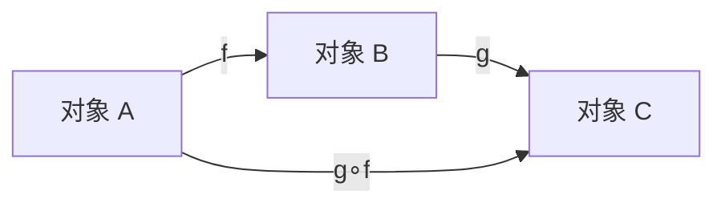
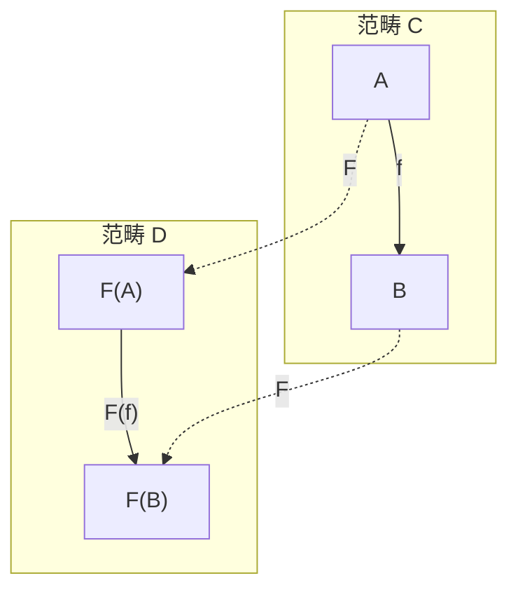
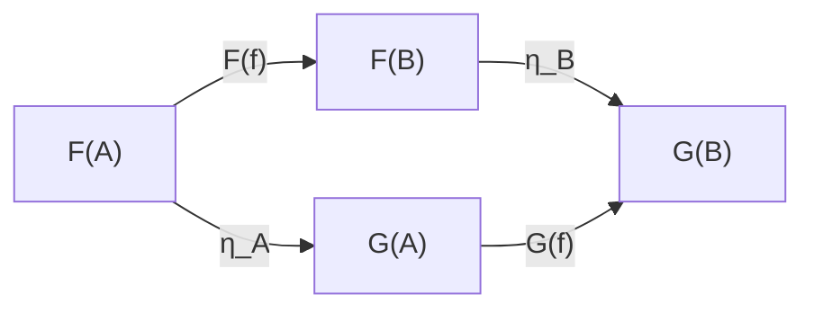
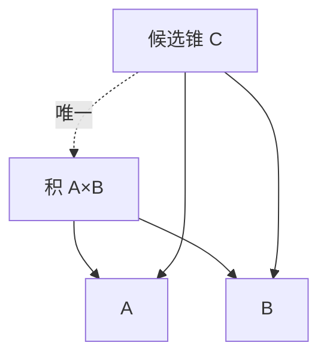
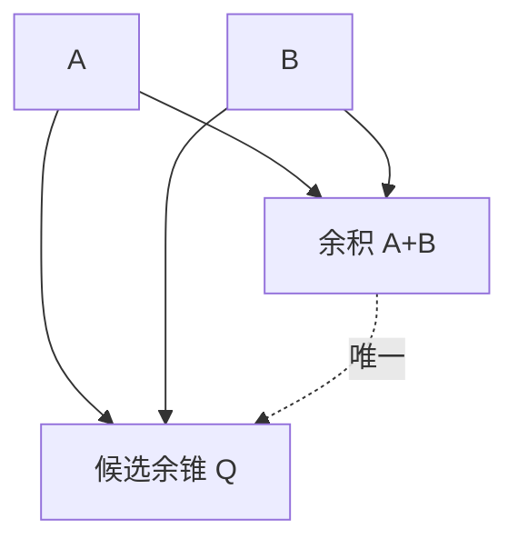

# SKILL: CTCS — Category Theory Conclusion Skill

## 0. 技能定位

CTCS 是 IVM/MVI 双向循环认知假设中 **Model 模块**的自上而下简单实验用例。  
它把任意材料转化为一个 **无问题导向** 的范畴论骨架总结：不先问“要解决什么问题”，只先问“材料中出现了哪些对象、态射、复合、函子、自然变换、极限/余极限、伴随、单子、Yoneda 结构”。

其产物写入 `reports/`，并作为下一步 **Value 模块**的输入：Value 模块再基于后续问题材料，把这些无问题导向图激活、裁剪、组合为 skill 类。

范畴论在这里的通俗逻辑学解释是：

> 把“证明”当作箭头，把“逻辑系统”当作箭头组成的网，然后研究这些网如何翻译、比较、构造、配对、包装，以及如何由关系决定对象。

---

## 1. 触发条件

当满足以下任一条件时启用本技能：

- 用户提供 `materials/` 文件夹，并要求做范畴论总结；
- 用户要求执行 CTCS、Category Theory Conclusion Skill；
- 用户要求从文本生成无问题导向的范畴论骨架图；
- 用户要求为 IVM/MVI 的 Value 模块准备 skill 类输入；
- 用户要求把文本、规范、实验记录、哲学段落或数学材料重述为对象表、态射表和交换图。

---

## 2. 输入

### 2.1 必需输入

- `materials/` 文件夹中的材料，可包含：
  - `.md`
  - `.txt`
  - `.tex`
  - `.pdf` 抽取文本
  - 代码、规范、实验记录、对话记录、自然语言笔记

### 2.2 可选输入

- 语言偏好；
- 形式化容忍度：严格 / 宽松；
- 是否允许外部检索补足；
- 是否输出 Mermaid 图；
- 指定范畴层级：单范畴 / 2-范畴 / 富范畴 / 拓扑斯等。

### 2.3 Model 阶段不使用的输入

- 后续问题材料；
- 目标导向、任务导向、价值导向的选择标准。

这些应留给 Value 模块。

---

## 3. 输出

所有输出写入 `reports/`。

每轮迭代生成一个独立报告，命名建议：

```text
reports/CTCS_<timestamp>_iter1.md
reports/CTCS_<timestamp>_iter2.md
reports/CTCS_<timestamp>_iter3.md
```

时间戳格式：

```text
YYYYMMDDTHHMMSSZ
```

每轮报告必须包含：

1. 文本类型与形式化程度；
2. 对象表；
3. 态射表；
4. 文字交换图或 Mermaid 图；
5. 范畴论重述 3—5 句；
6. 非范畴论通俗摘要；
7. 显式结构 vs 合理重构；
8. 信息缺失对象表；
9. 与上一轮的差异与收敛说明。

---

## 4. 核心流程

### 4.1 第一步：判断文本类型与形式化程度

对 `materials/` 中每个材料判断：

| 维度 | 取值 |
|---|---|
| 文本类型 | 数学论文、程序规范、哲学文本、实验记录、自然语言需求、混合材料 |
| 形式化程度 | 0 纯自然语言；1 半形式化；2 有类型/函数/规则；3 显式范畴语言；4 完整公理系统 |
| 范畴线索 | 是否出现对象、态射、函子、自然变换、极限、伴随、单子、Yoneda |
| 重构难度 | 低 / 中 / 高 |
| 处理策略 | 直接提取 / 合理重构 / 检索补足 / 标记信息缺失 |

原则：

- 高形式化材料优先直接提取；
- 低形式化材料允许重构，但必须标记为“合理重构/推测”；
- 不得把推测伪装成原文显式结构。

---

### 4.2 第二步：提取或重构范畴论骨架

使用以下骨架模板：

```text
范畴 C：
  Ob(C)：
  Hom(C)：
  复合 ∘：
  恒等 id：

函子 F: C → D：
自然变换 η: F ⇒ G：
极限/余极限：
伴随：
单子：
Yoneda：
```

形式化定义参考：

- 范畴 \(C\)：由对象类 \(Ob(C)\)、态射类 \(Hom(C)\)、复合 \(\circ\)、恒等 \(id_A\) 组成，满足结合律与恒等律。
- 函子 \(F: C \to D\)：把对象映为对象，把态射映为态射，并保持恒等与复合。
- 自然变换 \(\eta: F \Rightarrow G\)：对每个对象 \(A\) 给分量 \(\eta_A: F(A) \to G(A)\)，且满足自然性：
  \[
  G(f)\circ \eta_A = \eta_B \circ F(f)
  \]
- 极限/余极限：通过万有性质刻画锥/余锥。
- 伴随：\(F \dashv G\) 当且仅当存在自然同构
  \[
  Hom_D(F(A), B) \cong Hom_C(A, G(B))
  \]
- 单子：\(T: C \to C\)，配备 \(\eta: Id \Rightarrow T\) 与 \(\mu: T^2 \Rightarrow T\)，满足单位律与结合律。
- Yoneda：对象 \(A\) 由 \(\operatorname{Hom}(A,-)\) 或 \(\operatorname{Hom}(-,A)\) 完全决定。

---

### 4.3 第三步：明确区分显式结构与合理重构

每个结构项都必须标注：

| 标记 | 含义 |
|---|---|
| 显式 | 原文直接出现或明确可读 |
| 重构 | 为形成范畴骨架而合理补全 |
| 推测 | 证据不足，但暂时保留 |
| 信息缺失 | 无法从材料或检索中补足 |

输出时必须分栏列出，不得混合。

---

### 4.4 第四步：信息缺失处理

若文本不足以构成范畴，先尝试检索相关信息进行补足。  
若仍无法完成，则创建名为“信息缺失”的对象，并附注原因。

信息缺失对象表示例：

| 信息缺失对象 | 缺失维度 | 原因 | 影响 | 建议补足 |
|---|---|---|---|---|
| 信息缺失：复合封闭性 | 态射复合 | 原文只给对象关系，未给复合规则 | 无法验证范畴公理 | 寻找关系组合规则或定义 |
| 信息缺失：恒等态射 | 恒等 | 未出现平凡证明/保持操作 | 范畴不完整 | 显式构造 id |
| 信息缺失：目标范畴 | 函子余域 | 只出现翻译，未说明翻译到何处 | 函子不完整 | 指定目标逻辑系统 |
| 信息缺失：自然性方块 | 自然变换 | 缺少分量兼容条件 | 无法确认自然变换 | 补充交换图 |
| 信息缺失：万有性质 | 极限/余极限 | 只有合取/析取直觉，无锥/余锥 | 无法判定极限 | 补充泛性质 |

---

## 5. 输出表模板

### 5.1 对象表

| 对象 | 类型 | 原词 | 逻辑学解释 | 来源 | 显式/重构/推测 | 置信度 |
|---|---|---|---|---|---|---|
| \(A\) | 命题/类型/上下文/状态/资源/概念 |  | 命题、类型、上下文 | 段落/行号 | 显式 | 高 |

对象可包括：

- 命题；
- 类型；
- 上下文；
- 状态；
- 资源；
- 数据结构；
- 概念节点；
- 系统边界；
- 实验条件。

### 5.2 态射表

| 态射 | 源 | 目标 | 原词/关系 | 逻辑学解释 | 复合规则 | 恒等 | 来源 | 显式/重构/推测 | 置信度 |
|---|---|---|---|---|---|---|---|---|---|
| \(f: A \to B\) | \(A\) | \(B\) |  | 从 A 推出 B 的证明/推导 |  |  |  |  |  |

态射可包括：

- 证明；
- 推导；
- 函数；
- 映射；
- 因果；
- 翻译；
- 转换；
- 依赖；
- 更新；
- 计算步骤。

### 5.3 函子、自然变换与高阶结构表

| 结构 | 源 | 目标 | 直观含义 | 逻辑学解释 | 显式/重构 | 置信度 |
|---|---|---|---|---|---|---|
| 函子 \(F\) | 范畴 C | 范畴 D | 逻辑系统翻译 | 把命题翻译成命题，把证明翻译成证明 |  |  |
| 自然变换 \(\eta\) | \(F\) | \(G\) | 翻译之间的翻译证明 | 对每个命题给证明 \(F(A)\to G(A)\)，且与推理相容 |  |  |
| 极限 | 图 | 对象 | 合取/同时满足/约束 | 积像 \(A\land B\)，终对象像“真” |  |  |
| 余极限 | 图 | 对象 | 析取/至少一个/粘合 | 余积像 \(A\lor B\)，初始对象像“假” |  |  |
| 伴随 \(F \dashv G\) | \(F\) | \(G\) | 引入与消去配对 | 像量词、蕴词、柯里化 |  |  |
| 单子 | 范畴 C | 范畴 C | 效果/模态/计算包装 | 给证明加一层包装 |  |  |
| Yoneda | 对象 | 关系网 | 由关系决定对象 | 一个命题/对象由它与其他命题/对象的证明关系完全决定 |  |  |

---

## 6. 交换图模板

### 6.1 基本复合



### 6.2 函子



### 6.3 自然变换



### 6.4 极限/余极限直觉





---

## 7. 范畴论重述 3—5 句

每轮报告必须用 3—5 句写出范畴论重述。要求：

- 使用对象、态射、函子、自然变换、极限、伴随、单子、Yoneda 等语言；
- 明确哪些是显式，哪些是重构；
- 不引入问题导向判断；
- 若信息缺失，直接指出缺失维度。

示例句式：

> 材料可重构为一个范畴 \(C\)，其中对象是若干命题与上下文，态射是它们之间的推导关系。  
> 若材料中存在跨系统翻译，则将其重构为函子 \(F: C \to D\)，并检查其是否保持复合与恒等。  
> 若出现两种翻译之间的比较，则尝试构造自然变换 \(\eta: F \Rightarrow G\)，并验证自然性方块。  
> 材料中的合取/约束结构可视为极限，析取/粘合结构可视为余极限。  
> 若对象由与其他对象的关系完全决定，则可标记为 Yoneda 式结构；否则标记为信息缺失。

---

## 8. 非范畴论通俗摘要

每轮报告必须附一段非范畴论通俗摘要。要求：

- 尽量不使用“范畴、函子、自然变换”等术语；
- 用“命题、证明、翻译、比较、约束、选择、包装、关系决定对象”等逻辑学语言；
- 面向后续 Value 模块，但不提前做价值选择；
- 只说明材料中有什么、如何连接、哪些连接不确定。

示例：

> 这份材料可以看成一组概念和它们之间的推导关系。  
> 有些推导是在同一个系统内完成的，有些则像是把一套说法翻译成另一套说法。  
> 材料里还出现了“同时满足”和“至少一个”的结构，分别像合取与析取。  
> 目前缺少一些复合规则和恒等关系，因此还不能完全确认它构成一个完整范畴。

---

## 9. 三轮迭代机制

每轮都从第一步重新开始，不得只在上轮结果上局部修补。  
每轮输出独立时间戳，并归入 `reports/`。

### 第 1 轮：显式骨架抽取

目标：

- 找对象；
- 找态射；
- 找原词证据；
- 初步判断文本类型与形式化程度；
- 标记明显信息缺失。

### 第 2 轮：重构与公理检查

目标：

- 补全复合；
- 构造恒等；
- 检查结合律；
- 识别函子、自然变换；
- 补充交换图；
- 对外部检索补足的内容标注来源。

### 第 3 轮：高阶结构与收敛

目标：

- 识别极限/余极限；
- 识别伴随、单子、Yoneda；
- 比较三轮差异；
- 输出最终稳定骨架；
- 明确哪些结构仍为推测或信息缺失；
- 为 Value 模块准备可激活的图结构。

---

## 10. 质量门禁

生成报告前检查：

- 对象表是否有来源与置信度？
- 态射表是否有源、目标、复合规则？
- 复合是否封闭？
- 恒等是否显式或可构造？
- 函子是否保持恒等与复合？
- 自然变换是否满足自然性方块？
- 极限/余极限是否有万有性质？
- 伴随是否给出 Hom 同构或单位/余单位？
- 单子是否满足单位律与结合律？
- Yoneda 结构是否有关系决定对象的证据？
- 显式、重构、推测、信息缺失是否分开？
- 范畴论重述是否为 3—5 句？
- 非范畴论通俗摘要是否避免术语堆砌？
- 是否写入 `reports/` 并带时间戳？

---

## 11. 与 IVM/MVI 的接口

### Model 层

- 自顶向下生成无问题导向图；
- 不引入任务目标；
- 不裁剪与问题无关的结构；
- 输出范畴论骨架、对象表、态射表、交换图、信息缺失表。

### Value 层

- 读取 `reports/` 中的三轮报告；
- 基于后续问题材料激活、裁剪、组合图结构；
- 生成 skill 类；
- 将“信息缺失”对象转化为待检索或待定义任务；
- 将“显式/重构/推测”标记作为可信度先验。

---

## 12. 失败模式与处理

| 失败模式 | 处理 |
|---|---|
| 材料过弱，无法构成范畴 | 标记“信息缺失”对象，不强行编造 |
| 存在多个候选范畴 | 并列候选，标注证据与置信度 |
| 外部检索不可用 | 记录检索失败，保留缺失标记 |
| 文本过度形式化但无直观 | 保留自然语言通俗摘要 |
| 文本过度自然语言 | 只做谨慎重构，大量标记推测 |
| 函子目标范畴不明 | 标记“信息缺失：目标范畴” |
| 自然性无法验证 | 标记“信息缺失：自然性方块” |
| 极限/余极限只有直觉 | 标记“信息缺失：万有性质” |

---

## 13. 报告模板

```markdown
# CTCS Report — Iteration {n}

- Timestamp: {YYYYMMDDTHHMMSSZ}
- Source materials: materials/
- Iteration goal: {显式抽取 / 重构检查 / 高阶收敛}

## 1. 文本类型与形式化程度

## 2. 范畴论骨架

### 2.1 范畴 C
- Ob(C)：
- Hom(C)：
- 复合 ∘：
- 恒等 id：

### 2.2 函子
### 2.3 自然变换
### 2.4 极限/余极限
### 2.5 伴随
### 2.6 单子
### 2.7 Yoneda

## 3. 对象表

## 4. 态射表

## 5. 函子、自然变换与高阶结构表

## 6. 交换图 / Mermaid 图

## 7. 范畴论重述（3—5 句）

## 8. 非范畴论通俗摘要

## 9. 显式结构 vs 合理重构

## 10. 信息缺失对象表

## 11. 与上一轮差异与收敛说明
```

---

## 14. 使用指令

当用户要求执行 CTCS 时：

1. 读取 `materials/`；
2. 按第 4—8 节生成第 1 轮报告；
3. 写入 `reports/CTCS_<timestamp>_iter1.md`；
4. 从头重新执行，生成第 2 轮报告，写入 `reports/CTCS_<timestamp>_iter2.md`；
5. 从头重新执行，生成第 3 轮报告，写入 `reports/CTCS_<timestamp>_iter3.md`；
6. 最终回复中给出三轮报告路径、核心对象/态射数量、主要信息缺失项，以及供 Value 模块使用的接口说明。

---

## 15. 附录：逻辑学通俗映射

| 范畴论 | 逻辑学通俗解释 |
|---|---|
| 对象 \(Ob(C)\) | 命题、类型、上下文 |
| 态射 \(Hom(A,B)\) | 从 A 推出 B 的证明/推导 |
| 复合 \(g\circ f\) | 证明串接：A 推出 B，B 推出 C，所以 A 推出 C |
| 恒等 \(id_A\) | 平凡证明：A 推出 A |
| 函子 \(F:C\to D\) | 两个逻辑系统之间的翻译：把命题翻译成命题，把证明翻译成证明，并保持推理链 |
| 自然变换 \(\eta:F\Rightarrow G\) | 两种翻译之间的“翻译证明”：对每个命题 A，给一个证明 \(F(A)\to G(A)\)，且与推理相容 |
| 极限 | 偏“合取/同时满足/约束”：积像 \(A\land B\)，终对象像“真” |
| 余极限 | 偏“析取/至少一个/粘合”：余积像 \(A\lor B\)，初始对象像“假” |
| 伴随 \(F\dashv G\) | 引入规则与消去规则的配对，像量词、蕴词、柯里化 |
| 单子 | 给证明加一层“效果/模态/计算包装” |
| Yoneda | 一个命题/对象由它与其他命题/对象的证明关系完全决定 |

---

## 16. 最小成功标准

一次 CTCS 执行成功，当且仅当：

- `reports/` 中存在三轮带时间戳报告；
- 每轮都有对象表、态射表、交换图、3—5 句范畴论重述、非范畴论通俗摘要；
- 显式结构与合理重构被明确区分；
- 无法补足的部分被标记为“信息缺失”并附原因；
- 输出保持无问题导向；
- 结果可被 Value 模块继续用于生成 skill 类。