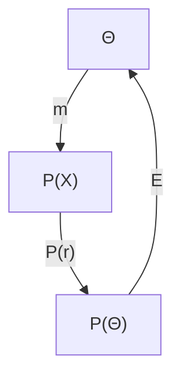
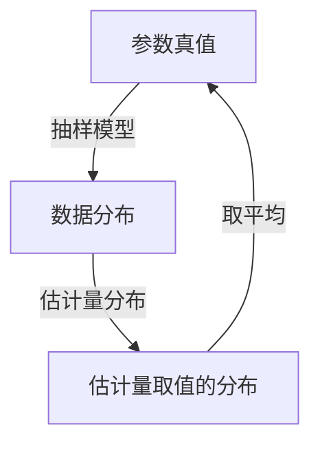

# 报告模板 · Mermaid 规范 · 标注规范

## 一、报告骨架（每轮都按此组织）

```markdown
# 范畴论取向总结 · 第 N 轮（定位词）

- **轮次**：RN                    ← 唯一时间标识在运行目录名上，报告内不写时间戳
- **材料**：<文件清单 + 页数/字数>
- **本轮定位**：<一句话说清这轮做什么，以及和上一轮的关系>

## 0. 四轮演化记录          ← 仅收敛轮需要
## 1. 文本类型与形式化程度
## 2. 基范畴（含各层与置信度）
## 3. 对象表 Ob(C)
## 4. 态射表 Hom(C)        ← 按层分组：概率层 / 推断层 / 线性层 / 决策层
## 5. 极限与余极限（系统盘点）
## 6. 伴随（含严格层级）
## 7. 自然变换
## 8. 单子与代数
## 9. 统一总图
## 10. 核心结论 / 统一
## 11. 重构的依赖与可证伪性分析   ← 收敛轮必须
## 12. 范畴论重述（3–5 句）
## 13. 对象「信息缺失」
## 14. 非范畴论通俗摘要
## 15. 本轮自评（供下一轮）
```

`check_reports.py` 只强制其中 6 项（轮次戳、对象表、态射表、交换图〔原图+翻译图〕、重述 3–5 句、通俗摘要、信息缺失），其余按材料需要增删，但**不要为了省事砍掉「基范畴」和「本轮自评」**——前者决定报告可复核，后者决定迭代能推进。

## 一之二、轮次戳取代每轮时间戳

- 文件名 `R1.md`…`R4.md`，报告头写 `- **轮次**：R1`，**两者必须一致**（门禁校验）
- 报告内**不得**再出现 `- **时间戳**：...` 字段（门禁会拦）
- 时间信息只落在两处：运行目录名（`runs/20261012-142200/`）与 `00_INDEX.md`
- 理由：每轮各带一个时间戳，会让同一批产物出现多个时间标识，归档时无法回答
  「这一批是什么时候跑的」。轮次戳负责顺序，运行目录名负责时间，两者分工不重叠

## 二、表格规范

对象表列：`ID | 对象 | 含义 | 出处 | 显式性 | 置信度`
态射表列：`态射 | 类型 | 出处 | 显式性 | 置信度`

- **出处必须精确到页码或章节**（如 `W2 p16`），不能写"讲义中提到"
- 态射表**按层分组**，用 `###` 小标题分开。混在一起会失去结构感
- 「信息缺失」作为**一行**进入对象表，同时在 §13 展开为完整表格

## 三、Mermaid 书写规范（踩过的坑）

**必须遵守**

1. **节点命名以骨架表为准**：原图的每个节点标签必须能在**对象表第一列**找到，每条箭头标签必须能在**态射表第一列**找到。不得自造节点名——门禁逐个比对并点名未见于骨架表的标签
   - 因此**第一列必须是可直接用于 Mermaid 节点命名的记号**（`Θ`、`P(X)`、`m`），中文名放第二列。若第一列写成中文，「同一个记号在表里两份写法」会让节点比对全部失配
   - 中文名（第二列）不参与比对，翻译图可以放心使用它们
2. **图必须成对**：每张原图之后必须紧接一张**通俗化翻译图**（见下节）
3. 节点标签一律用**双引号包裹**：`A["Θ"]`——中文、希腊字母、下标都安全
4. 边标签一律用 `|"..."|` 包裹：`A -->|"m"| B`
5. 换行用 `<br/>`，不要用真实换行。注意：门禁比对时会**截断 `<br/>` 之后的内容**，只取前半段与骨架表比对，因此骨架表名必须放在 `<br/>` 之前
6. 子图用 `subgraph 名字["显示名"]`，内部可加 `direction LR`
7. 代码块围栏必须配对（门禁会数 ` ``` ` 的奇偶）

## 三之二、原图 + 通俗化翻译图（成对产出）

每张范畴论图都要配一张翻译图：**图结构不变，节点/箭头名换成用户领域里的说法**。
目的是让只懂本领域、不懂范畴论的读者能顺着同一张图读下去。

写法（用 `###` 子标题分开。**门禁靠子标题判定图块的类型**，不是靠关键词搜索）：

````markdown
### 3.1 原图（范畴论骨架）



### 3.2 翻译图（用户领域概念）


````

判定口径（四条，全在门禁里）：

| 要求 | 判定 |
| --- | --- |
| 每个图块都有类型 | 每个 Mermaid 块向上找最近的子标题，标题须含「原图 / 范畴论 / 骨架」或「翻译 / 通俗 / 领域」之一；落在别的标题下的图无法判定类型，会被点名 |
| 有原图且有翻译图 | 原图与翻译图必须**交替出现**，每张原图紧接一张翻译图；两者都必须是真的 Mermaid 代码块 |
| 翻译图必须是图 | 用「≥2 行的翻译对照表」顶替翻译图**不算满足**——要求是生成一张图 |
| 翻译图真翻译 | 翻译图的标签若**仍全部出自骨架表**，或与对应原图的标签重合过半，判为未做通俗化 |

图件的存在与否只看 Mermaid 代码块，不看正文里有没有箭头或「翻译」二字。
曾经的实现靠正文关键词判定，导致一份通篇没有图的报告也能通过，该缺陷已修复。

翻译用词的取舍：

- **优先用材料自己的说法**。材料里叫「总体参数」就写「总体参数」，不要写成「参数空间」
- 不要在新图里保留范畴符号（`P(X)`、`μ`、`∘`）——保留即视为未翻译
- 同一个骨架概念在**各轮、各图**里必须用同一个译名；换译名要在「本轮自评」里说明
- 若材料里找不到对应说法，说明这条骨架是重构出来的：译名后加「（重构）」，并进可证伪性分析表

**禁止**

- 裸写特殊字符：`⊗ ⊕ ⊨ ⟺ ↦` 等在**引号外**可能破坏解析，务必放进引号内
- 节点标签里出现未转义的双引号
- 一个图里塞超过约 12 个节点——拆成多图，图之间用正文串起来

**推荐配色（暗色主题）**

```
style A fill:#2d3748,stroke:#90cdf4,color:#e2e8f0
```

深色底 + 浅色字。浅色主题下改为浅底深字。**不要用裸色类名**（如 `c-purple`），未实现时会回退成黑色。

**文字交换图（补充说明用，不能顶替 Mermaid 图）**

```
          m_n
    Θ ───────────► P(𝓧ⁿ)
```

用 `──►`、`▼`、`│` 等框线字符，标注清楚"交换"的断言是什么。

**重要**：文字图**不能替代** Mermaid 图去满足「原图 + 翻译图成对」的门禁要求。
门禁只认 Mermaid 代码块；若某张图画不出 Mermaid（例如渲染环境受限），把它放到附录，
正文那一组仍必须是 Mermaid，否则整份报告会被判「图未成对」。

## 四、置信度标注规范

| 星级 | 含义 | 什么时候给 |
| --- | --- | --- |
| ★★★★★ | 严格数学对应，文献可查 | 材料显式 + 标准定理 |
| ★★★★☆ | 严格，但依赖本总结选定的基范畴 | 需选定基范畴才能成立的结论 |
| ★★★☆☆ | 合理结构推广，依赖自建范畴结构 | 本总结自建了范畴结构才能说 |
| ★★☆☆☆ | 启发式类比 | 只是"看起来像" |

**规则**：★★★☆☆ 及以下必须在「可证伪性分析」里写明**它依赖什么自建结构**、**什么条件下会被推翻**。

## 五、范畴论重述的写法

- **严格 3–5 句**，编号列出
- 每句要能独立成立，不依赖前一句的代词指代
- 每句覆盖骨架的一个不同层面（建议：① 基范畴与单子 ② 主线复合与性质 ③ 函子/方法 ④ 分解与极限 ⑤ 决策与对偶）
- 不要用「综上所述」开头，不要用「我们可以看到」

## 六、通俗摘要的写法

- **不出现**「范畴」「态射」「函子」「自然变换」「单子」「伴随」「极限」「Yoneda」
- 按材料**原始章节顺序**组织，读者应能把它当材料本身的导读
- 末尾给 1–2 条**贯穿暗线**：把分散在各章的同一件事点出来
  - 这是范畴化的收益兑现点。若写不出暗线，说明骨架没抽到统一处，应回去补步骤 2

## 七、可证伪性分析表（收敛轮必须）

| 重构 | 若被推翻，连带影响 | 可证伪条件 |
| --- | --- | --- |
| <结论> | <哪些章节会一起失效> | <什么观察会推翻它> |

**作用**：让读者知道哪几条是硬的、哪几条是软的。没有这张表，整份报告的置信度标注等于没做。
